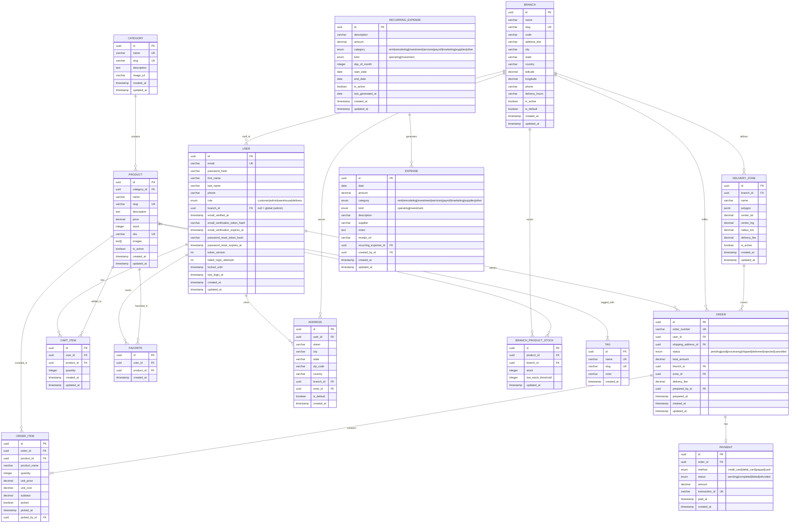

# 🗄️ Diagrama Entidad-Relación - Market E-commerce

> Este documento define el modelo de datos base para la aplicación Market.
> Está diseñado para PostgreSQL y será implementado con TypeORM en NestJS.

---

## 📊 Diagrama ER (Mermaid)

---

## 📋 Descripción de Entidades

### `users`
Almacena la información de clientes, administradores y empleados de bodega.

| Campo | Tipo | Descripción |
|-------|------|-------------|
| `id` | `uuid` | Identificador único (PK) |
| `email` | `varchar` | Correo electrónico, único |
| `password_hash` | `varchar` | Contraseña encriptada con bcrypt |
| `first_name` | `varchar` | Nombre |
| `last_name` | `varchar` | Apellido |
| `phone` | `varchar` | Teléfono de contacto |
| `role` | `enum` | `customer`, `admin`, `warehouse` o `delivery` |
| `branch_id` | `uuid` | Sucursal asignada al staff (`warehouse`/`delivery`). `null` = alcance global (admin) |
| `email_verified_at` | `timestamp` | Fecha de verificación del correo (null = no verificado) |
| `email_verification_token_hash` | `varchar` | Hash SHA-256 del token de verificación vigente |
| `email_verification_expires_at` | `timestamp` | Expiración del enlace de verificación (24 h) |
| `password_reset_token_hash` | `varchar` | Hash SHA-256 del token de reseteo vigente |
| `password_reset_expires_at` | `timestamp` | Expiración del enlace de reseteo (30 min) |
| `token_version` | `int` | Versión del JWT; se incrementa para invalidar sesiones |
| `failed_login_attempts` | `int` | Intentos fallidos consecutivos |
| `locked_until` | `timestamp` | Bloqueo temporal tras demasiados intentos |
| `last_login_at` | `timestamp` | Último login exitoso |
| `created_at` | `timestamp` | Fecha de registro |
| `updated_at` | `timestamp` | Última actualización |

### `branches`
Sucursales físicas donde opera el negocio (ej. Guanare, Acarigua). Todo pedido queda asociado a una sucursal.

| Campo | Tipo | Descripción |
|-------|------|-------------|
| `id` | `uuid` | Identificador único |
| `name` | `varchar` | Nombre visible de la sucursal |
| `slug` | `varchar` | Identificador URL-friendly (único) |
| `code` | `varchar` | Código corto (ej. `GUA`) |
| `address_line` | `varchar` | Dirección física |
| `city` / `state` / `country` | `varchar` | Ubicación |
| `latitude` / `longitude` | `decimal` | Centro de la sucursal |
| `phone` | `varchar` | Teléfono de contacto |
| `delivery_hours` | `varchar` | Horario de entrega |
| `is_active` | `boolean` | Sucursal operativa |
| `is_default` | `boolean` | Sucursal por defecto (fallback) |

### `delivery_zones`
Zonas de cobertura de una sucursal. El cliente solo puede marcar direcciones dentro del polígono (o radio) de la zona.

| Campo | Tipo | Descripción |
|-------|------|-------------|
| `id` | `uuid` | Identificador único |
| `branch_id` | `uuid` | FK a la sucursal |
| `name` | `varchar` | Nombre de la zona |
| `polygon` | `jsonb` | Array de vértices `{ lat, lng }` |
| `center_lat` / `center_lng` | `decimal` | Centro (para cobertura por radio) |
| `radius_km` | `decimal` | Radio de cobertura en km (alternativo al polígono) |
| `delivery_fee` | `decimal` | Costo de envío de la zona (hoy 0 = gratis) |
| `is_active` | `boolean` | Zona habilitada |

### `branch_product_stock`
Inventario por sucursal. El stock global de `products.stock` se mantiene como agregado.

| Campo | Tipo | Descripción |
|-------|------|-------------|
| `id` | `uuid` | Identificador único |
| `product_id` | `uuid` | FK al producto |
| `branch_id` | `uuid` | FK a la sucursal |
| `stock` | `integer` | Unidades disponibles en la sucursal |
| `low_stock_threshold` | `integer` | Umbral de stock bajo |

> **Restricción:** `(product_id, branch_id)` es único.

### `categories`
Categorías de productos.

| Campo | Tipo | Descripción |
|-------|------|-------------|
| `id` | `uuid` | Identificador único |
| `name` | `varchar` | Nombre de la categoría |
| `slug` | `varchar` | URL amigable |
| `description` | `text` | Descripción |
| `image_url` | `varchar` | Imagen representativa |

### `products`
Catálogo de productos.

| Campo | Tipo | Descripción |
|-------|------|-------------|
| `id` | `uuid` | Identificador único |
| `category_id` | `uuid` | FK a categoría |
| `name` | `varchar` | Nombre del producto |
| `slug` | `varchar` | URL amigable |
| `description` | `text` | Descripción detallada |
| `price` | `decimal` | Precio unitario |
| `stock` | `integer` | Unidades disponibles |
| `sku` | `varchar` | Código de inventario |
| `images` | `text[]` | Array de URLs de imágenes |
| `is_active` | `boolean` | Visible en tienda |

### `tags`
Etiquetas para agrupar productos de diferentes categorías.

| Campo | Tipo | Descripción |
|-------|------|-------------|
| `id` | `uuid` | Identificador único |
| `name` | `varchar` | Nombre del tag (único) |
| `slug` | `varchar` | URL amigable (único) |
| `color` | `varchar` | Color hex para la UI (opcional) |

### `product_tags`
Tabla intermedia para relación Many-to-Many entre productos y tags.

| Campo | Tipo | Descripción |
|-------|------|-------------|
| `productId` | `uuid` | FK al producto |
| `tagId` | `uuid` | FK al tag |

### `cart_items`
Items del carrito de compras por usuario.

| Campo | Tipo | Descripción |
|-------|------|-------------|
| `id` | `uuid` | Identificador único |
| `user_id` | `uuid` | FK al usuario |
| `product_id` | `uuid` | FK al producto |
| `quantity` | `integer` | Cantidad solicitada |

> **Restricción:** Un usuario no puede tener dos veces el mismo producto en el carrito. Se actualiza la cantidad.

### `favorites`
Productos guardados como favoritos por cada usuario.

| Campo | Tipo | Descripción |
|-------|------|-------------|
| `id` | `uuid` | Identificador único |
| `user_id` | `uuid` | FK al usuario |
| `product_id` | `uuid` | FK al producto |

> **Restricción:** Un usuario no puede guardar dos veces el mismo producto. El par `(user_id, product_id)` es único.

### `orders`
Pedidos realizados.

| Campo | Tipo | Descripción |
|-------|------|-------------|
| `id` | `uuid` | Identificador único |
| `order_number` | `varchar` | Número legible del pedido (ej: ORD-000001) |
| `user_id` | `uuid` | FK al usuario |
| `shipping_address_id` | `uuid` | FK a dirección de envío |
| `status` | `enum` | Estado del pedido: `pending`, `paid`, `processing`, `shipped`, `delivered`, `rejected` o `cancelled` |
| `total_amount` | `decimal` | Monto total (incluye `delivery_fee` si aplica) |
| `branch_id` | `uuid` | FK a la sucursal que despacha el pedido |
| `zone_id` | `uuid` | FK a la zona de cobertura que aplicó |
| `delivery_fee` | `decimal` | Costo de envío (0 = gratis) |
| `prepared_by_id` | `uuid` | FK al usuario de bodega que armó el pedido (quién inicia la preparación) |
| `prepared_at` | `timestamp` | Fecha/hora en que el pedido se completó y pasó a `shipped` |

### `order_items`
Detalle de productos dentro de un pedido.

| Campo | Tipo | Descripción |
|-------|------|-------------|
| `id` | `uuid` | Identificador único |
| `order_id` | `uuid` | FK al pedido |
| `product_id` | `uuid` | FK al producto |
| `product_name` | `varchar` | Nombre del producto al momento de la compra |
| `quantity` | `integer` | Cantidad |
| `unit_price` | `decimal` | Precio unitario al momento de la compra |
| `unit_cost` | `decimal` | Costo unitario del producto al momento de la compra (snapshot para margen histórico) |
| `subtotal` | `decimal` | quantity × unit_price |
| `picked` | `boolean` | Marca de artículo preparado (checklist de picking), default `false` |
| `picked_at` | `timestamp` | Fecha/hora en que se marcó el artículo como preparado |
| `picked_by_id` | `uuid` | FK al usuario de bodega que marcó el artículo |

### `payments`
Registro de pagos asociados a pedidos.

| Campo | Tipo | Descripción |
|-------|------|-------------|
| `id` | `uuid` | Identificador único |
| `order_id` | `uuid` | FK al pedido |
| `method` | `enum` | Método de pago |
| `status` | `enum` | Estado del pago |
| `amount` | `decimal` | Monto pagado |
| `transaction_id` | `varchar` | ID de transacción externo |
| `paid_at` | `timestamp` | Fecha de pago |

### `expenses`
Registro de gastos del negocio (operativos e inversiones).

| Campo | Tipo | Descripción |
|-------|------|-------------|
| `id` | `uuid` | Identificador único |
| `date` | `date` | Fecha del gasto |
| `amount` | `decimal` | Monto |
| `category` | `enum` | `rent`, `remodeling`, `investment`, `services`, `payroll`, `marketing`, `supplies` u `other` |
| `kind` | `enum` | `operating` (resta utilidad neta) o `investment` (se muestra aparte) |
| `description` | `varchar` | Descripción |
| `supplier` | `varchar` | Proveedor (opcional) |
| `notes` | `text` | Notas (opcional) |
| `receipt_url` | `varchar` | Comprobante (opcional) |
| `recurring_expense_id` | `uuid` | FK a la plantilla que lo generó, si aplica |
| `created_by_id` | `uuid` | Usuario administrador que lo registró |
| `created_at` / `updated_at` | `timestamp` | Auditoría |

### `recurring_expenses`
Plantillas de gastos que se generan automáticamente cada mes.

| Campo | Tipo | Descripción |
|-------|------|-------------|
| `id` | `uuid` | Identificador único |
| `description` | `varchar` | Descripción |
| `amount` | `decimal` | Monto mensual |
| `category` | `enum` | Categoría del gasto |
| `kind` | `enum` | `operating` o `investment` |
| `day_of_month` | `integer` | Día de generación (1–28) |
| `start_date` / `end_date` | `date` | Vigencia |
| `is_active` | `boolean` | Activa o pausada |
| `last_generated_at` | `date` | Último gasto generado |
| `created_at` / `updated_at` | `timestamp` | Auditoría |

### `addresses`
Direcciones de envío de los usuarios.

| Campo | Tipo | Descripción |
|-------|------|-------------|
| `id` | `uuid` | Identificador único |
| `user_id` | `uuid` | FK al usuario |
| `street` | `varchar` | Calle y número |
| `city` | `varchar` | Ciudad |
| `state` | `varchar` | Estado/Provincia |
| `zip_code` | `varchar` | Código postal |
| `country` | `varchar` | País |
| `branch_id` | `uuid` | Sucursal que cubre la dirección (resuelta por coordenadas/ciudad) |
| `zone_id` | `uuid` | Zona de cobertura que contiene la dirección |
| `latitude` / `longitude` | `decimal` | Coordenadas de entrega |
| `is_default` | `boolean` | Dirección principal |

---

## 🔗 Relaciones

| Relación | Tipo | Descripción |
|----------|------|-------------|
| `users` → `orders` | 1:N | Un usuario puede tener muchos pedidos |
| `users` → `cart_items` | 1:N | Un usuario tiene múltiples items en carrito |
| `users` → `favorites` | 1:N | Un usuario puede guardar varios productos favoritos |
| `users` → `addresses` | 1:N | Un usuario puede tener varias direcciones |
| `categories` → `products` | 1:N | Una categoría tiene muchos productos |
| `products` → `cart_items` | 1:N | Un producto puede estar en muchos carritos |
| `products` → `favorites` | 1:N | Un producto puede ser favorito de muchos usuarios |
| `products` → `order_items` | 1:N | Un producto puede estar en muchos pedidos |
| `products` ↔ `tags` | M:N | Un producto puede tener múltiples tags y viceversa |
| `orders` → `order_items` | 1:N | Un pedido tiene varios items |
| `orders` → `payments` | 1:1 | Un pedido tiene un pago asociado |
| `users` → `orders` | 1:N | Un usuario de bodega puede preparar muchos pedidos (`prepared_by_id`) |
| `users` → `order_items` | 1:N | Un usuario de bodega puede marcar muchos artículos (`picked_by_id`) |
| `recurring_expenses` → `expenses` | 1:N | Una plantilla genera un gasto por mes |
| `users` → `expenses` | 1:N | Un administrador registra muchos gastos (`created_by_id`) |

---

## 📝 Notas de Implementación

- Todos los IDs usarán `uuid` generados por PostgreSQL (`gen_random_uuid()`).
- Los precios se almacenarán como `decimal(10,2)` para evitar errores de punto flotante.
- Las contraseñas nunca se guardan en texto plano; siempre con `bcrypt`.
- Los tokens de verificación y reseteo se guardan únicamente como hash SHA-256, son de un solo uso y tienen expiración.
- Los usuarios nuevos deben verificar su correo antes de iniciar sesión. Las cuentas creadas por un administrador se marcan como verificadas.
- `token_version` permite invalidar todas las sesiones al verificar el correo, cambiar/restablecer la contraseña o cerrar sesión en todos los dispositivos.
- El carrito se limpia automáticamente al crear una orden exitosa.
- `order_items` guarda una copia del nombre, precio y costo del producto para mantener el histórico y calcular márgenes reales.
- Los gastos `operating` restan de la utilidad neta; los gastos `investment` se reportan aparte.
- Los gastos recurrentes generan una fila mensual idempotente por plantilla mediante un cron diario.
- El estado `processing` corresponde al pedido en preparación (picking/packing) por un usuario de bodega. El flujo de preparación es `paid → processing → shipped`.
- El usuario `warehouse` solo accede a su panel (`/warehouse`) y a los endpoints del módulo Warehouse; el administrador crea estos usuarios desde el panel de usuarios.
- El checklist de picking (`order_items.picked`) se persiste, junto con `picked_at`/`picked_by_id` y `orders.prepared_by_id`/`prepared_at`, para trazabilidad y auditoría.
- La sucursal del pedido se resuelve automáticamente por las coordenadas de la dirección dentro de una `delivery_zones`; el cliente puede cambiarla desde el navbar (`branch_id` explícito) siempre que la dirección siga dentro de la cobertura de esa sucursal.
- Las direcciones con coordenadas fuera de toda zona se rechazan con `400` al guardarse. Si no hay coordenadas, se resuelve por ciudad/estado.
- `users.branch_id` limita las colas de `warehouse` y `delivery` a su sucursal. Los administradores con `branch_id = null` ven todas.
- El dashboard y el listado de pedidos aceptan `?branchId=` (`all` o UUID) para filtrar estadísticas por sucursal.
- `branch_product_stock` guarda el inventario real por sucursal; `products.stock` se mantiene como agregado global para compatibilidad y reportes.

---

## 🔄 Próximos Pasos

1. Implementar entidades en NestJS con TypeORM.
2. Crear migraciones iniciales.
3. Generar seeders de categorías y productos de prueba.
4. Implementar módulos de Auth, Products, Cart, Orders y Payments.
